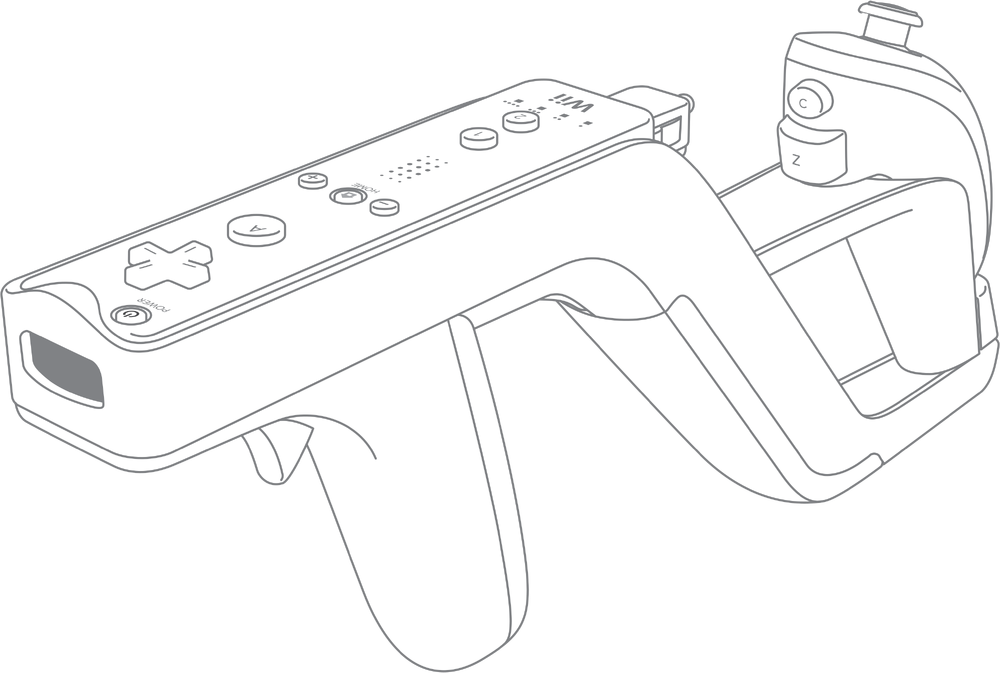
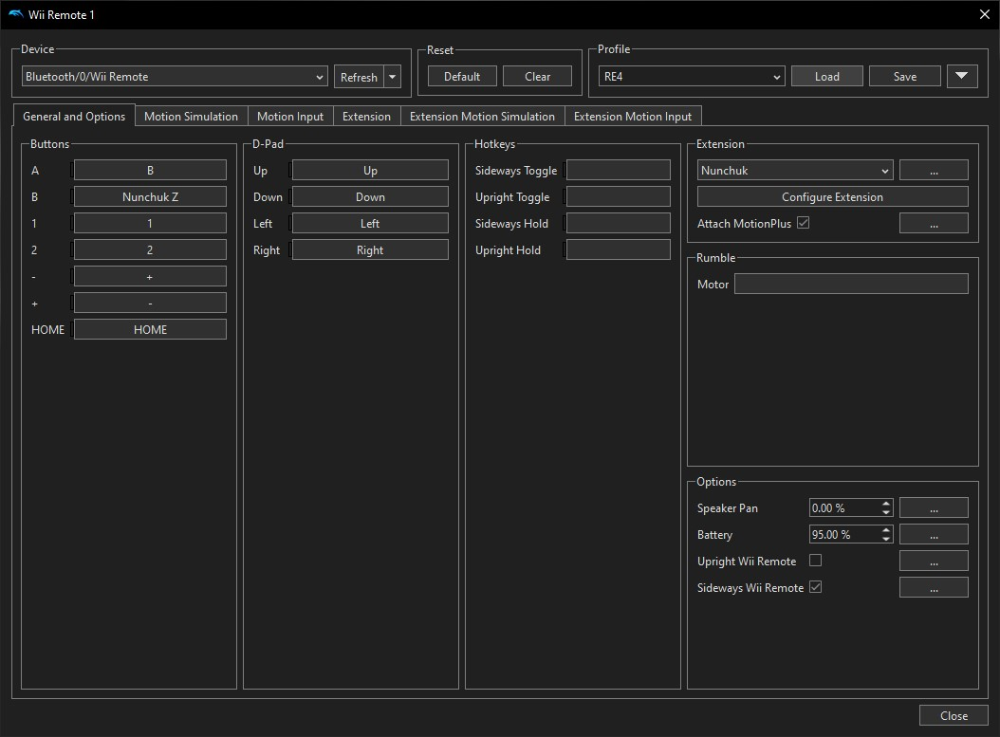
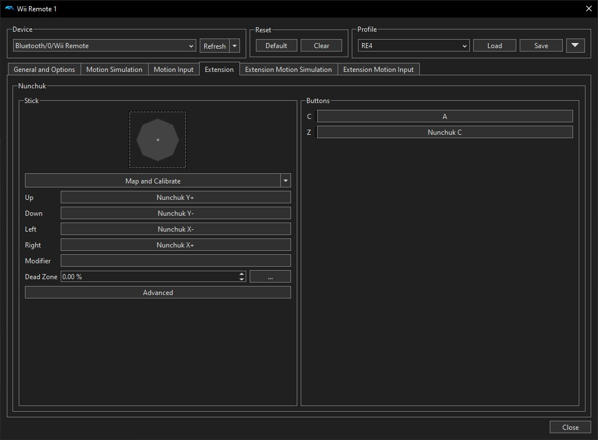
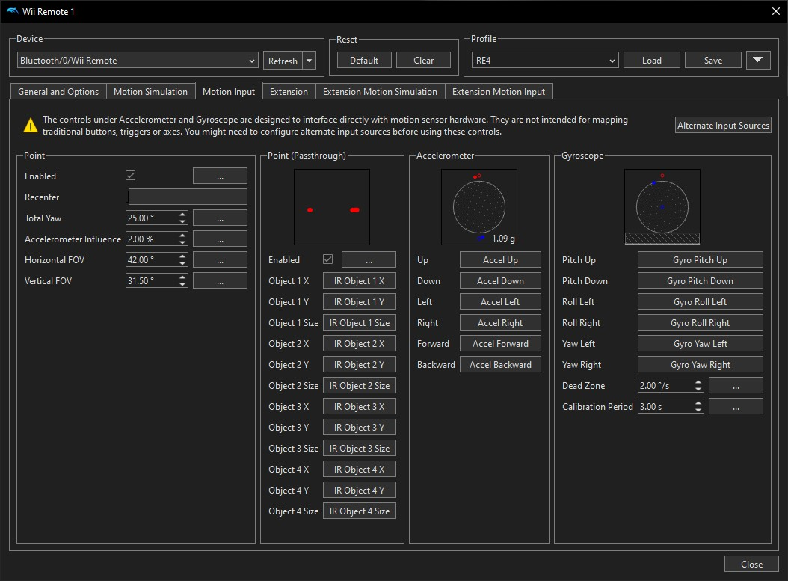

# Resident Evil 4: Wii Edition — Remapped Zapper Controls

  
  

[Download RE4 Wii Zapper Controller Profile](config/RE4.ini)

## About This Project:

This repository includes documentation and a custom Dolphin Wii Remote configuration file, specifically remapped for use with the Wii Zapper attachment to provide a more intuitive, comfortable, and immersive gameplay experience.

The most important change is **using B to shoot instead of A**, allowing you to use the Wii Remote's trigger as an actual trigger. Other buttons have also been remapped to make aiming, shooting, movement, and other actions feel more natural when using the Zapper.

This guide is for those who don't like the original Wii controls, or anyone interested in playing RE4 Wii Edition with a Wii Zapper Attachment.

I have also uploaded my config file, so you can simply drop it into your directory. [config/RE4.ini](config/RE4.ini)

(Be sure to edit the file for your mote and save).

  

## Setup & Configuration:

### Requirements:

You must use **Dolphin Emulator**.

and you also need a...

- [x] **OEM Wii Remote**
  - I recommend OEM with MotionPlus, just for future peace of mind.
- [x] **OEM Wii Nunchuk**
- [x] **Wii Zapper Attachment**
  - Non-licensed versions work just the same.
- [x] **USB Sensor Bar** (A MUST)
  - I recommend a USB sensor bar with built-in Bluetooth capabilities, especially if you don't have a Bluetooth receiver.
  - Although I have a TP-Link receiver, I did experience connection issues when connecting multiple controllers.
- [x] **Appropriate hardware and software** (PC specs, Dolphin, your own game file, etc.)

Once these requirements are met, set up your Dolphin Wii-Mote settings. **This part is important.**

> [!WARNING]
> Always wear the Wii Remote wrist strap and make sure it's securely fastened, especially when using the Wii Zapper. Be careful during motion-based QTEs (Quick Time Events), as sudden movements can cause you to accidentally hit something or someone nearby. Make sure you account for the size of the Zapper attachment and its range of movement.

---

### Wii-Mote Button Remapping: 

| Wii-Mote Button | Remapped Button |
|---|---|
| A | B |
| B | Z |
| − | + |
| + | − |
| C | A |
| Z | C |

All other controls remain the same.

#### Additional Settings

- **Extension:** Nunchuk
- **Enable:** Point (Passthrough)
- **Name and save your profile.**

Other settings will depend on your hardware.

### How the Controls Work

With these controls:

- **Z — Aim / Back**
  - Like you're readying from the hip.
- **B — Shoot / Confirm**
  - An actual trigger to confirm the shot, and it's in front of the aiming button.
- **C — Sprint / Quick Turn**
  - Next to the joystick and other movement controls.
- **A — Knife Strike**
  - A is directly above B, allowing for quicker switching than the original scheme.

As for the + and − buttons, that's just a quality-of-life change for me personally, since I use the inventory button more than the command button.

Having the inventory on the side my pointer finger can reach the easiest, reduces strain. 

**FYI:** QTEs use the actual Wii B and Z buttons now.

I also like having my sensor bar at the bottom (configured in Dolphin settings), since it's more comfortable for longer sessions.

[Download RE4 Wii Zapper Controller Profile](config/RE4.ini)

---

### Dolphin Configuration Images

**1. Wii Remote — General and Options**

**2. Nunchuk — Extension**

**3. Motion Input — Pointer Passthrough**

## Why the Wii Version?

GameCube graphics, PlayStation 2 additional content (i.e., Separate Ways, etc.), and options for standard GamePad OR Motion Controls.

It is by far the best-rounded release of the original game, and is what the PC port was based on! The Wii-mote motion controls are very impressive, even by 2026 standards.

Lastly, it's absolutely tragic that the Wii port of RE4 doesn't have a proper Zapper attachment control scheme. They work so well together!

## What is Resident Evil 4?

Developed and published by Capcom, **Resident Evil 4 (2005)** is a survival-horror action game and one of my personal favorite video games of all time.

RE4 helped revolutionize interactive entertainment through its innovative over-the-shoulder camera and its horrifying stop-to-shoot gunplay, establishing a standard that would influence countless games for years to come.

From its gameplay and atmosphere to its influence on modern gaming, Resident Evil 4 remains one of the most important and influential video games ever made.

## Conclusion:

### Why I Made This Setup

I was in the mood to replay the game, and it was around the time I resurrected my childhood Wii. So I got the game and was immediately disappointed in the control scheme.

The Wii version uses **A to shoot and B to aim**, which I found absolutely horrible, especially when using the Wii Zapper. What's even more confusing is that the B button itself is shaped like a trigger, yet they chose A to shoot.

The other controls were a little better, but could still be improved upon. **Z was used for sprinting and quick turns, C for the knife stance, and + and − for commands and inventory**, respectively. The overall button layout felt poorly thought out, especially when using the Zapper.

Using the Zapper actually made the controls more uncomfortable than playing without it, since I had to position my finger over the barrel of the Zapper just to reach the A button to shoot. The button layout felt poorly thought out and not at all worthy of a game like RE4.

Additionally, I would note that Resident Evil 4: Wii Edition was released on **June 19, 2007**, while the Wii Zapper wasn't released until **November 19, 2007**, five months later.

This feels like a missed opportunity. With RE4 Wii Edition releasing before the Zapper, the controls weren't designed with the attachment in mind, which is a shame considering how well the two work together.

I wanted to play the Wii Edition because of its motion controls, but I also wanted to use the Zapper in a way that actually felt comfortable, intuitive, and immersive.

That's why I decided to experiment with Dolphin Emulator and create my own custom control layout.

With a few simple button changes, I was able to make aiming, shooting, and movement feel much more natural with the Zapper, without changing the core gameplay.

### My Experience

I just completed my first playthrough with this setup in **Spring 2026**, and I had a blast.

I never had the game crash or anything while playing. Dolphin Emulator really surprised me.

I did experience frame drops, but only in certain sections (Minecart Section).

The only real problem was "Pointer Drift" lol, which was fixed by enabling Pointer Passthrough. Sometimes certain Wii Remotes also don't like to reconnect automatically, but that's about it.

(Also, no laser sight, just a generic crosshair 😞)

All of this, coupled with the fact that the Wii port is basically GameCube graphics with PS2 DLC, means you should have an absolutely wonderful playthrough on your hands.

I just wanted to share this so someone else may have as much fun as I did.

**I hope you'll give it a try!**
