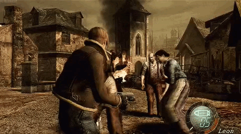

# Resident Evil 4: Wii Edition — Remapped Zapper Controls

  
  

## Why This Setup?

I tried RE4 Wii Edition, and hated the controls.

This guide is for those who don't like the original Wii controls, or anyone interested in playing RE4 Wii Edition with a Wii Zapper.

## What is Resident Evil 4?

Developed and published by Capcom, **Resident Evil 4 (2005)** is a survival horror action game and one of my personal favorite video games of all time.

RE4 helped revolutionize interactive entertainment through its innovative and polished over-the-shoulder camera and horrifying stand-still shooting, establishing a standard that would influence countless games for years to come.

From its gameplay and atmosphere to its influence on modern gaming, Resident Evil 4 remains one of the most important and influential video games ever made.

## Why the Wii version?

GameCube graphics, PlayStation 2 Additional Content (i.e., Separate Ways, etc), GamePad OR Motion Controls.
It is by far the best-rounded release of the original game, and is what the PC port was based on! The Wii also has very impressive Motion Controls, even by 2026 standards. 
Lastly, it's absolutely tragic that the Wii port of RE4 doesn't have a proper Zapper attachment control scheme, they work so well together! 

# SETUP & CONFIGURATION

## Requirements

You must use **Dolphin Emulator**.

What you'll need:

- **OEM Wii Remote** (I recommend w/MotionPlus, just for future peace of mind.)
- **OEM Wii Nunchuk**
- **Wii Zapper Attachment** (Non-Lisenced version works all the same.)
- **USB Sensor Bar** (A MUST, Dolphin sells their own sensor bar with added Bluetooth capabilities. I recommend that, especially if you don't have a Bluetooth receiver. Although I have a TP-Link receiver, I did experience connection issues when connecting multiple controllers.)
- **Appropriate hardware and software** (PC specs, Dolphin, your own game file, etc.)

Once these requirements are met, set up your Dolphin settings. **This part is important.**

## Dolphin Configuration

### Controller Settings

Image 1

### Wii Remote Button Remapping

| Wii Remote Button | Remap To |
|---|---|
| A | B |
| B | Z |
| − | + |
| + | − |
| C | A |
| Z | C |

All other controls remain the same.

### Additional Settings

- **Extension:** Nunchuk
- **Enable:** Point (Passthrough)
- **Name and save your profile.**

Other settings will depend on your hardware.

## How the Controls Work

With these controls:

- **Z** becomes your Aim / Back button.
  - (Like your readying from the hip)
- **B** becomes your Shoot / Confirm button.
  - (An actual trigger to confirm the shot, and it's in front of the aiming button)
- **C** becomes your Sprint / Quick Turn button.
  - (Next to Joystick and other Movement control schemes)
- **A** becomes your Knife Stance button.
  - (A is directly above B, creating a binary tree of options, and quicker switching speeds from the original scheme)

As for the + and − buttons, that's just a quality-of-life change for me personally, since I use the inventory button more than the command button.

**FYI:** QTEs use the actual Wii B and Z buttons now.

I also like having my sensor bar at the bottom (configured in Dolphin settings), since it's more comfortable for longer sessions.

# PERSONAL NOTES

## Why This Setup?

I was in the mood to replay the game, and it was around the time I resurrected my childhood Wii. So I got the game and was immediately disappointed in the control scheme.

The Wii version uses **A to shoot and B to aim**, which I found absolutely horrible, especially when using the Wii Zapper. What's even more confusing is that the B button itself is shaped like a trigger, yet they chose A to shoot.

Using the Zapper actually made the controls more uncomfortable than playing without it, since I had to position my finger over the barrel of the Zapper just to reach the A button to shoot. The button layout felt poorly thought out and not at all worthy of a game like RE4.

Additionally, I would note that Resident Evil 4: Wii Edition was released on **June 19, 2007**, while the Wii Zapper wasn't released until **November 19, 2007**, five months later.

This feels like a missed opportunity. With RE4 Wii Edition releasing before the Zapper, the controls weren't designed with the attachment in mind, which is a shame considering how well the two couldv'e / already work together so well.

I wanted to play the Wii Edition because of its motion controls, but I also wanted to use the Zapper in a way that actually felt comfortable, intuitive, and immersive.

That's why I decided to experiment with Dolphin Emulator and create my own custom control layout.

With a few simple button changes, I was able to make aiming, shooting, and movement feel much more natural with the Zapper, without changing the core gameplay.

This guide is for anyone who dislikes the original Wii controls or is interested in experiencing RE4 Wii Edition with a Wii Zapper.

I just completed my first playthrough (Spring 2026) with this setup, and I had a blast.

## My Experience

I never had the game crash or anything while playing. Dolphin Emulator really surprised me. (Spring 2026)

I did experience frame drops, but only in certain sections (Minecart Section).

The only real problem was "Pointer Drift" lol, which was fixed by enabling Pointer Passthrough. Sometimes certain Wii Remotes also don't like to reconnect automatically, but that's about it.

(Also, no laser sight, just a generic crosshair 😞)

All of this, coupled with the fact that the Wii port is basically GameCube graphics with PS2 DLC, means you should have an absolutely wonderful playthrough on your hands.

I just completed my first playthrough, and I had a blast.

I really hated how they did the original Wii controls. A to shoot and B to aim? Absolutely horrible with the Zapper.

The RE4 Wii port came out a couple of months before the Zapper, which is very disappointing.

I just wanted to share this so someone else may have as much fun as I did.

**I hope you'll give it a try!**
